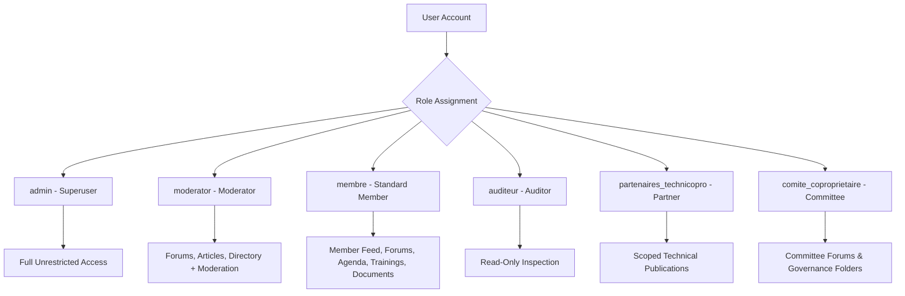

# ARCHICOPRO Extranet — Complete User Manual

Welcome to the official **Website User Manual** for the **ARCHICOPRO Extranet** (`passarinhama-frontend` / `archicopro-frontend`).

This comprehensive guide is designed for association members, committee delegates, technical partners, moderators, and system administrators. It explains every page, tool, form, button, permission, and workflow implemented across the digital collaborative hub of the French professional association of co-ownership architects (*Compagnie des Architectes de Copropriété*).

---

## 📑 Table of Contents

1. [Introduction](#1-introduction)
2. [Website Overview](#2-website-overview)
3. [Getting Started](#3-getting-started)
4. [User Roles](#4-user-roles)
5. [Login and Account Management](#5-login-and-account-management)
   - [5.1 Member Login](#51-member-login)
   - [5.2 Requesting a New Membership (Signup)](#52-requesting-a-new-membership-signup)
   - [5.3 Two-Factor OTP Verification](#53-two-factor-otp-verification)
   - [5.4 Password Recovery & Reset](#54-password-recovery--reset)
   - [5.5 Profile & Self-Service Account Management](#55-profile--self-service-account-management)
6. [Navigation Guide](#6-navigation-guide)
   - [6.1 Layout Overview](#61-layout-overview)
   - [6.2 Collapsible Sidebar & Dynamic Category Tree](#62-collapsible-sidebar--dynamic-category-tree)
   - [6.3 Top Navigation Bar & Omnibox Global Search](#63-top-navigation-bar--omnibox-global-search)
   - [6.4 Online Members Indicator](#64-online-members-indicator)
   - [6.5 Language Switcher (French / English)](#65-language-switcher-french--english)
7. [Complete Module-by-Module Guide](#7-complete-module-by-module-guide)
   - [7.1 Member Home Portal (`/`)](#71-member-home-portal-)
   - [7.2 Member Directory (`/directory`)](#72-member-directory-directory)
   - [7.3 Articles & Publications (`/articles`, `/articles/:slug`)](#73-articles--publications-articles-articlesslug)
   - [7.4 Agenda & Calendar Events (`/agenda`, `/agenda/:agendaId`)](#74-agenda--calendar-events-agenda-agendaagendaid)
   - [7.5 Alternate Events Calendar (`/events`, `/events/:eventId`)](#75-alternate-events-calendar-events-eventseventid)
   - [7.6 Professional Training Courses (`/trainings`, `/trainings/:trainingId`)](#76-professional-training-courses-trainings-trainingstrainingid)
   - [7.7 TechnicoPro Technical Hub (`/technicopro`, `/technicopro/:technicoproId`)](#77-technicopro-technical-hub-technicopro-technicoprotechnicoproid)
   - [7.8 Document Library & Cloud Storage (`/documents`)](#78-document-library--cloud-storage-documents)
   - [7.9 Community Forums & Discussions (`/forums`)](#79-community-forums--discussions-forums)
   - [7.10 Administration Control Center (`/admin`)](#710-administration-control-center-admin)
   - [7.11 Moderation Desk (`/admin` Moderation Tab)](#711-moderation-desk-admin-moderation-tab)
   - [7.12 Executive Analytics Dashboard (Unrouted Overview)](#712-executive-analytics-dashboard-unrouted-overview)
8. [All CRUD Operations](#8-all-crud-operations)
9. [All Forms and Input Fields Summary](#9-all-forms-and-input-fields-summary)
10. [File Upload and Download Guide](#10-file-upload-and-download-guide)
11. [Search, Filtering, and Sorting](#11-search-filtering-and-sorting)
12. [Role-Based Actions and Permissions](#12-role-based-actions-and-permissions)
13. [Step-by-Step User Workflows](#13-step-by-step-user-workflows)
14. [Validation and Error Messages](#14-validation-and-error-messages)
15. [Troubleshooting](#15-troubleshooting)
16. [Frequently Asked Questions (FAQ)](#16-frequently-asked-questions-faq)
17. [Glossary](#17-glossary)

---

## 1. Introduction

The **ARCHICOPRO Extranet** is a dedicated digital workspace engineered for architects specializing in co-ownership (*copropriété*), property syndics, technical partners, and association administrators. 

The platform fosters knowledge exchange, standardizes technical architectural guidelines, coordinates continuing professional education, organizes statutory general assemblies and conferences, and archives mission-critical association documentation in a secure, role-governed environment.

> [!NOTE]
> This manual documents the existing frontend web application. All documented features reflect executable React components, client-side route guards, interactive modal forms, and local authorization logic verified directly in source code.

---

## 2. Website Overview

The extranet consists of interconnected collaborative modules:
- **Member Portal**: The central landing feed showcasing pinned discussions, upcoming calendar assemblies, featured training webinars, and recent technical publications.
- **Member Directory**: The professional roster of accredited architects, searchable by name, location, and professional firm.
- **Knowledge Library (Articles & TechnicoPro)**: Peer-reviewed architectural, legal, and diagnostic publications with rich typography, table formatting, and document attachments.
- **Interactive Agenda**: A full-featured monthly/weekly calendar grid tracking association assemblies, technical working groups, and member registrations.
- **Document Cloud**: Hierarchical folder explorer for sharing official blueprints, regulatory templates, forms, and archived files.
- **Discussions & Forums**: Three-tier community forum (Category ➔ Topic ➔ Thread Replies) with rich WYSIWYG authoring, image galleries, and YouTube video embeds.
- **Superuser Administration Panel**: Comprehensive 8-tab administrative suite managing members, role matrices, forum categories, SMTP mail servers, system logs, and automated backup schedules.

---

## 3. Getting Started

### System Requirements & Browser Compatibility
The ARCHICOPRO Extranet is accessible via any modern, standards-compliant web browser supporting HTML5, JavaScript ES2022, and CSS Flexbox/Grid:
- Google Chrome v100+
- Mozilla Firefox v100+
- Apple Safari v16+
- Microsoft Edge v100+
- Mobile browsers on iOS (Safari) and Android (Chrome)

### Network & URL Access
Access the web extranet through your designated organization domain (e.g. `https://extranet.archicopro.example.com` or local development server `http://localhost:5173`).

---

## 4. User Roles

The system evaluates capabilities through two layers: **System Role Slugs** and **Granular Feature Action Grants**.

### Detailed Role Personas:
1. **Administrator / Superuser (`admin`)**:
   - Holds `is_superuser === true`.
   - Complete, unrestricted access to all 9 tabs of the Administration Panel (`/admin`).
   - Authority to create, edit, delete, publish, pin, and restore content across all owners.
   - Authority to modify shared categories, forum containers, root folders, SMTP settings, logs, and system backups.
2. **Moderator (`moderator`)**:
   - Focuses on content governance and discussion moderation.
   - Access to member forums, publications, member directory, and the Moderation Desk.
3. **Standard Member (`membre`)**:
   - Accredited architect member of the association.
   - Access to member portal feed, discussions, articles, calendar event registrations, training courses, and permitted document folders.
   - May create new content when permitted; may edit or delete **only their own** self-authored content.
4. **Auditor (`auditeur`)**:
   - Inspects association records, minutes, documents, and training sessions.
   - Typically holds read-only grants (`can_view: true`) across feature domains.
5. **Technical Partner (`partenaires_technicopro`)**:
   - Industrial partner contributing technical expertise, product specifications, and regulatory standards.
   - Access scoped to the TechnicoPro library and designated technical working group forums.
6. **Co-ownership Committee (`comite_coproprietaire`)**:
   - Board and advisory members accessing statutory assembly agendas, committee minutes, and private governance folders.

---

## 5. Login and Account Management

### 5.1 Member Login
- **Route**: `/login`
- **Who can access**: Any unauthenticated visitor.

#### How to Sign In:
1. Navigate to `/login`.
2. Enter your registered email address in the **Email** field (`login.email`).
3. Enter your account password in the **Password** field (`login.password`).
4. (Optional) Click the **Eye icon** inside the password input to reveal or mask your password characters.
5. Click the yellow **Sign in** button (`login.submit`).
6. Upon authentication, you will be redirected to the Member Home Portal (`/`).
7. If your account is awaiting administrator payment validation, a warning banner will inform you that your profile status is pending.

---

### 5.2 Requesting a New Membership (Signup)
- **Route**: `/signup`
- **Who can access**: Prospective architect members.

#### How to Request Membership:
1. From the login screen, click **Request Membership** or navigate directly to `/signup`.
2. Fill out all required fields:
   - **First Name** (`signup.firstName`): e.g., "Jean".
   - **Last Name** (`signup.lastName`): e.g., "Dupont".
   - **Professional Email** (`signup.professionalEmail`): e.g., `architect@cabinet.fr`.
   - **Password** (`signup.password`): Minimum 8 characters.
   - **Confirm Password** (`signup.confirmPassword`): Must match password.
3. Click **Request Membership** (`signup.requestMembership`).
4. The system will send a 6-digit verification code to your email and navigate automatically to `/verify-otp`.

---

### 5.3 Two-Factor OTP Verification
- **Route**: `/verify-otp`
- **Who can access**: Users completing signup or resetting their password.

#### How to Verify:
1. Check your email inbox for the 6-digit numeric verification code.
2. Enter the six digits into the input boxes. You may also paste the full 6-digit code directly into the first box.
3. The cursor will advance automatically after each digit.
4. Click **Verify Identity** (`otp.verifyIdentity`).
5. If the timer reaches `0s`, you can click **Resend Verification Code** (`otp.resendVerificationCode`) to request a fresh code.

---

### 5.4 Password Recovery & Reset
- **Route**: `/forgot-password`
- **Who can access**: Any member who has forgotten their password.

#### Step 1: Request Verification Code
1. Click **Forgot Password?** (`login.forgotPassword`) on the login screen.
2. Enter your registered email address.
3. Click **Send Instructions** (`forgotPassword.sendInstructions`).
4. You will be redirected to `/verify-otp` to enter the verification code.

#### Step 2: Set New Password
1. After successfully entering the OTP, you are returned to `/forgot-password` in reset mode.
2. Your email is displayed as read-only.
3. Enter your **New Password** (`forgotPassword.newPassword`).
4. Re-enter it in **Confirm New Password** (`forgotPassword.confirmNewPassword`).
5. Click **Reset Password** (`forgotPassword.resetPassword`).
6. You will see a success confirmation and be redirected to `/login`.

---

### 5.5 Profile & Self-Service Account Management
- **Route**: `/profile`
- **Who can access**: Any logged-in member.

#### 1. Updating Personal Information
1. Open the sidebar and click on your user card at the bottom, or navigate to `/profile`.
2. In the **Personal Information** section, modify any of the following fields:
   - First Name, Last Name, Professional Email (Enforced Required)
   - Phone, Mobile, Society/Firm Name, Department, City, Street Address (Optional)
3. Click **Save Changes** (`profilePage.saveChanges`). A green status notification will confirm the update.

#### 2. Uploading a Profile Avatar
1. Hover over your profile photo circle on the left card.
2. Click the camera icon or avatar image.
3. Select an image file (`.png`, `.jpg`, `.jpeg`, `.webp`, `.svg`) from your device.
4. The file uploads immediately and refreshes your avatar across the top navigation bar and comments.

#### 3. Changing Your Password
1. Scroll down to the **Security & Password** card.
2. Enter your **Current Password** (`profilePage.currentPassword`).
3. Enter your **New Password** (`profilePage.newPassword`).
4. Re-type it in **Confirm New Password** (`profilePage.confirmNewPassword`).
5. Click **Update Password** (`profilePage.updatePassword`).

#### 4. Managing Email Notification Preferences
1. Scroll to the **Notification Preferences** panel on the left sidebar.
2. Toggle individual switches for notification categories:
   - New article published
   - New event created
   - Forum reply posted
   - Training course announced
3. Toggling a switch saves your preference immediately to your profile.

---

## 6. Navigation Guide

### 6.1 Layout Overview
The extranet uses a responsive, high-contrast dashboard shell:
- **Left Sidebar**: Persistent on desktop viewports (`>= 1024px`); slides in as an overlay drawer on mobile/tablet screens.
- **Top Sticky Header**: Shows current section title, omnibox search, language switch, external website link, and mobile hamburger menu trigger.
- **Main Scrolling Viewport**: Content canvas displaying active pages, listing grids, and detail views.

---

### 6.2 Collapsible Sidebar & Dynamic Category Tree
The sidebar organizes navigation into dynamic sections:
- **Home (`/`)**: Main portal dashboard.
- **Agenda (`/agenda`)**: Interactive calendar and events.
- **Articles (`/articles`)**: Expandable dropdown accordion listing article categories with dynamic infinite scroll.
- **Forums (`/forums`)**: Expandable dropdown accordion listing active forum containers.
- **Training (`/trainings`)**: Expandable dropdown accordion listing training categories.
- **TechnicoPro (`/technicopro`)**: Expandable dropdown accordion listing technical categories.
- **Documents (`/documents`)**: Hierarchical document folder explorer.
- **Members (`/directory`)**: Directory of accredited members (visible if granted `user.view`).
- **Administration (`/admin`)**: Unified control center (visible exclusively to active superusers).

---

### 6.3 Top Navigation Bar & Omnibox Global Search
The global search input in the top header provides unified search across all extranet domains:
- **How to Search**: Type your query (e.g. "acoustique", "assemblée générale", "DPE").
- **Auto-Search**: The search triggers automatically after 300 milliseconds of inactivity, or immediately upon pressing **Enter**.
- **Results Dropdown**: Displays up to 10 categorized matches with badges (`Articles`, `Forums`, `Topics`, `Agenda`, `Trainings`, `Documents`).
- **Permissions Filter**: The client automatically hides results from domains you do not have permission to view.
- **Clear**: Click the **X** button inside the search box or press **Escape** to close the search popover.

---

### 6.4 Online Members Indicator
Located at the bottom of the sidebar:
- Shows the real-time count of currently active members online.
- Displays up to 5 member avatars with green presence dots and names.

---

### 6.5 Language Switcher (French / English)
The extranet is fully bilingual:
- Click the **Language Switcher** pill (`FR` / `EN`) in the top navigation bar or auth screens.
- Instantly toggles all interface labels, modal titles, validation errors, and localized date formats between French and English without reloading the page.

---

## 7. Complete Module-by-Module Guide

### 7.1 Member Home Portal (`/`)
The **Member Home Portal** is your starting feed upon logging in.

#### What You See:
1. **Access Restriction Notice**: If your account dues are pending administrator validation, a yellow notification callout appears at the top.
2. **Pinned Community Discussions**: Compact cards highlighting active topics pinned across forums.
3. **Upcoming Events**: Calendar date-badge cards showing upcoming assemblies, conferences, and webinars with locations. Click any card to view event details.
4. **Professional Trainings**: Featured training modules with syllabus summaries and dates.
5. **Latest Articles**: Recently published legal and architectural articles with cover images and read times.
6. **"View All →" Buttons**: Each section header features a yellow button navigating directly to the full module catalogue.

---

### 7.2 Member Directory (`/directory`)
- **Route**: `/directory`
- **Permission Required**: `user.view` (Ordinary members) / Superuser for administration.

#### Available Actions:
- **Search & Filter**: Type in the search box to find colleagues by name, email, city, or firm. Filter by account status tabs (`All`, `Active`, `Pending`, `Suspended`).
- **Inspect Member Card**: View contact details, phone numbers, mobile, city, company, and annual membership validation badges.
- **Create New Member** (`user.create`):
  1. Click the **Add Member** button (`memberDirectory.addMember`).
  2. Complete required fields: First Name, Last Name, Professional Email, and Initial Password (min 8 characters).
  3. Optionally provide telephone, mobile, firm, city, and avatar image.
  4. *(Superusers only)*: Assign user role, status (`active`, `pending`, `suspended`), annual payment validation, and superuser flag.
  5. Click **Save Changes** (`memberDirectory.saveChanges`).
- **Edit Member Profile** (`user.edit` / Superuser): Click the **Pencil icon** on any member card to update details.
- **Archive / Soft Delete Member** (Superuser): Click the **Trash icon** to soft-delete an account.
- **Restore Suspended Member** (Superuser): Click **Restore Member** on a suspended card to reactivate their account.
- **Export Directory to CSV** (Superuser): Click **Export CSV** in the header to download the complete member directory roster.

---

### 7.3 Articles & Publications (`/articles`, `/articles/:slug`)
- **Route**: `/articles` (Catalogue) and `/articles/:slug` (Reader)
- **Permission Required**: `article.view`

#### Catalogue View Features:
- **Category Filter**: Select categories from the sidebar or click category pill buttons to scope articles.
- **Status Tabs**: Authors and administrators can switch between **Published** and **Draft** articles.
- **Pagination**: Navigate between pages using the `<` and `>` pagination controls.

#### How to Write a New Article:
1. Click **Write Article** (`articlesPage.writeArticle`).
2. Complete the form:
   - **Title**: Article headline.
   - **Category**: Select the topic category from the dropdown.
   - **Status**: Choose `Draft` or `Published`.
   - **Excerpt**: Enter a 1–2 sentence summary for preview cards.
   - **Content Editor**: Write your full article using the Tiptap rich-text editor (supports formatting, headings, bullet lists, tables, links, YouTube embeds, and inline image uploads).
   - **Thumbnail**: Drag and drop a cover image (Enforced Required).
   - **Attachments**: Drag and drop supporting PDF guidelines, blueprints, or documents.
3. Click **Create Article** (`articlesPage.createArticle`).

#### Managing Your Articles:
- **Edit Article**: Click the **Pencil icon** on any card you authored (or any article if Superuser).
- **Publish Draft**: Click the **Globe icon** on an unpublished draft to publish it immediately.
- **Delete Article**: Click the **Trash icon** and confirm deletion in the popup dialog.
- **Category Management** (Superuser): Click **Categories** in the header to add, edit, or delete article categories.

---

### 7.4 Agenda & Calendar Events (`/agenda`, `/agenda/:agendaId`)
- **Route**: `/agenda`
- **Permission Required**: `event.view`

#### Interactive Calendar Features:
- **Monthly & Weekly Navigation**: Click `<` and `>` to switch months, or use the Year/Month dropdown pickers.
- **Today Button**: Instantly jumps back to the current day.
- **Event Chips**: Shows colored category dots on days with scheduled events.
- **Day List Drawer**: On mobile or narrow screens, selecting a day count badge opens a drawer listing all events on that day.

#### Viewing Event Details & Registration:
1. Click any event chip or upcoming event card.
2. A detailed side drawer opens showing event title, date, time, location, description, and attachments.
3. **Self-Service Registration**:
   - If not yet registered: Click **Register for Event** (`agendaPage.registerForEvent`). The attendee counter increments immediately.
   - If already registered: Click **Cancel Registration** (`agendaPage.cancelRegistration`).
4. **Attendee Roster** (Superuser & Event Creator): Click the **Participants** tab to view the list of registered members.

#### Scheduling a New Event (`event.create`):
1. Click the yellow **+ Create Event** button (`agendaPage.createEvent`).
2. Enter event details:
   - Title, Start Date, End Date, Time, Location (e.g. "Zoom" or physical address).
   - Category (colors calendar dots according to category hex code).
   - Maximum Attendees limit.
   - Rich-text description and attachments.
   - "Public Event" checkbox.
3. Click **Create Event** (`agendaPage.createEvent`).

---

### 7.5 Alternate Events Calendar (`/events`, `/events/:eventId`)
- **Route**: `/events`
- **Permission Required**: `event.view`
- An alternate calendar view offering simplified monthly event browsing and a "Quick Add Event" form. Created events are synchronized directly with the central agenda backend.

---

### 7.6 Professional Training Courses (`/trainings`, `/trainings/:trainingId`)
- **Route**: `/trainings` (Catalogue) and `/trainings/:trainingId` (Course Syllabus)
- **Permission Required**: `training.view`

#### Features:
- Browse accredited webinars, technical certifications, and courses.
- Filter by category or toggle between **Published** and **Draft** courses.
- Inspect detailed course syllabus with instructor details, duration, objectives, and downloadable PDF course packs.
- Propose new training modules (`training.create`): Provide title, category, syllabus description, cover thumbnail, and syllabus attachments.

---

### 7.7 TechnicoPro Technical Hub (`/technicopro`, `/technicopro/:technicoproId`)
- **Route**: `/technicopro`
- **Permission Required**: `technicopro.view`

#### Features:
- Technical specifications, acoustic standards, facade restoration techniques, thermal insulation regulations, and diagnostic templates contributed by technical partners and specialist commissions.
- Supports rich-text authoring, embedded technical tables, downloadable blueprints, and category filters.

---

### 7.8 Document Library & Cloud Storage (`/documents`)
- **Route**: `/documents` (Root) and `/documents/folder/:folderId` (Subfolder)
- **Permission Required**: `document.view`

#### Features:
- **Hierarchical Navigation**: Explore folders and nested subfolders with breadcrumb navigation.
- **Grid vs. List View**: Toggle between icon card grid and compact table list view.
- **Create Subfolder** (`document.create` + Folder upload capability):
  1. Click **New Folder** (`documentLibraryPage.newFolder`).
  2. Enter the folder name.
  3. Click **Create Folder**.
- **Upload Document** (`document.create` + Folder upload capability):
  1. Navigate into the target folder.
  2. Click **Upload File** (`documentLibraryPage.uploadFileTitle`).
  3. Drag and drop a file or browse your device.
  4. Click **Upload File**.
- **Inspect & Preview Document**: Click any document to open the inspection drawer:
  - Preview images, audio files, videos, PDFs, and text files directly in the browser.
  - View metadata: file size, format, upload date, and uploader identity.
- **Download Document**: Click the **Download** button to download the private file via an authenticated binary stream.
- **Rename Item**: Click the three dots menu ➔ **Rename** to update folder or file names.
- **Delete Item**: Click **Delete** to remove a document (Owner or Superuser) or folder (Superuser only).

---

### 7.9 Community Forums & Discussions (`/forums`)
- **Route**: `/forums` (Forum Directory), `/forums/:forumId` (Topic List), and `/forums/:forumId/topics/:topicId` (Discussion Thread)
- **Permission Required**: `forum.view`

#### Three-Tier Forum Structure:
1. **Forum Categories (`/forums`)**:
   - Lists thematic forum categories (e.g., General Discussions, Legal & Syndic Commission, Technical Questions).
   - Shows total topic and reply counts, moderator names, and category thumbnails.
2. **Topic Discussions List (`/forums/:forumId`)**:
   - Lists discussion threads inside the selected forum.
   - Pinned discussions appear at the top with a yellow pin badge.
   - Displays reply counts, view counts, original author avatar, and last activity date.
   - **Create Topic** (`forum.create` + `can_post`): Click **New Topic**, provide title, full rich text, and optional file attachments.
3. **Discussion Thread View (`/forums/:forumId/topics/:topicId`)**:
   - Read the original post and chronological replies.
   - View uploaded attachment previews, inline images, and YouTube video embeds.
   - **Post a Reply**: Scroll to the bottom inline editor, compose your message, attach any documents, and click **Post Reply** (`forumsPage.postReply`).
   - **Edit / Delete Reply**: Authors can edit or delete their own replies using the action buttons on their post card.
   - **Pin Topic** (Superuser): Click the **Pin icon** in the header to pin or unpin a topic across the extranet.

---

### 7.10 Administration Control Center (`/admin`)
- **Route**: `/admin`
- **Permission Required**: **Active Superuser only** (`is_superuser === true`).

The Admin Panel organizes association governance into **8 control tabs**:

#### Tab 1: Members Administration
- Complete directory table with sorting and filtering.
- Filter by status (`active`, `pending`, `suspended`) or search by name.
- **Actions**: Create new accounts, edit profiles, validate annual membership payment, soft-delete (archive), restore suspended members, permanently delete records, and export member directory CSV.

#### Tab 2: Forums Management
- Create, edit, and delete forum category containers.
- Manage responsible commission heads, forum descriptions, and cover thumbnails.

#### Tab 3: Articles Management
- Review all submitted articles across members.
- Publish pending drafts with one click.
- Create, edit, and delete articles and article categories.

#### Tab 4: Events Management
- Schedule association assemblies and conferences.
- Set attendance limits and inspect attendee rosters.

#### Tab 5: Professional Trainings Management
- Author, edit, or delete professional courses and syllabus files.

#### Tab 6: Moderation Desk
- Embedded moderation queue listing user posts reported or pending review.
- One-click decisions: **Approve**, **Reject**, or **Flag** with a required moderator note.
- Complete audit trail tracking moderator decisions and timestamps.

#### Tab 7: Roles & Permissions Matrix
- **System Roles**: Create, edit, or delete system roles (`admin`, `moderator`, `membre`, etc.).
- **Role Permissions Matrix**: Configure grants (`can_view`, `can_create`, `can_edit`, `can_delete`) across all 7 domain features.
- **Member Direct Overrides**: Select individual members to grant or revoke specific privileges independently of their role.

#### Tab 8: System Settings & Backups
- **SMTP Email Configuration**: Host, Port, Username, Password, TLS/SSL Encryption, Default Sender Email, and live test email trigger.
- **System Logs**: Live log inspector, download system `.log` file, and clear logs.
- **Database & Media Backups**: View backup archives, trigger immediate manual backup, configure automated schedule (Daily, Weekly, Monthly), download backup archives, and delete historic backups.

---

### 7.11 Moderation Desk (`/admin` Moderation Tab)
Moderators and administrators use the Moderation Desk to govern community discussions:
- **Queue**: Displays pending and reported topics/replies with author details and post snippets.
- **Approve**: Immediately validates the post, making it visible to all members.
- **Reject**: Removes the post from public view. Requires entering an explanation note for audit logs.
- **Flag**: Marks the post for senior committee review.

---

### 7.12 Executive Analytics Dashboard (Unrouted Overview)
`src/pages/Dashboard.tsx` provides executive analytics for association leadership:
- Real-time counters for Total Members, Active Discussions, Upcoming Events, Published Articles, and Completed Trainings.
- Dynamic activity stream showing real-time member publications and registrations.
- Online member roster.
> *Note: This component exists in the codebase but is not registered in the router.*

---

## 8. All CRUD Operations

For detailed step-by-step CRUD operations across every resource, refer to **[CRUD_AND_PERMISSIONS_MATRIX.md](CRUD_AND_PERMISSIONS_MATRIX.md)**.

### Summary of Rules:
1. **CREATE**: Available if the user holds `can_create` for that feature AND container write permissions are satisfied (`can_post` for forums, `can_upload` for folders).
2. **READ**: Available if the user holds `can_view` for that feature.
3. **UPDATE**: Available if the user holds `can_edit` AND is the verified creator/author (or is an active Superuser).
4. **DELETE**: Available if the user holds `can_delete` AND is the verified creator/author (or is an active Superuser). Forum topic deletion by ordinary owners is permitted only if `reply_count === 0`.
5. **CATEGORIES & CONTAINERS**: Managing shared categories, document folders, and forum containers is restricted to **active Superusers**.

---

## 9. All Forms and Input Fields Summary

The website implements **33 distinct interactive forms and dialogs** comprising **168 input fields**.

For the exhaustive specification table containing every input type, placeholder, default value, validation regex, and source code reference, please consult **[FORM_FIELD_REFERENCE.md](FORM_FIELD_REFERENCE.md)**.

---

## 10. File Upload and Download Guide

For technical specifications regarding file types, accepted MIME types, binary download handlers, local preview leases, and deletion security, refer to **[FILE_OPERATIONS_REFERENCE.md](FILE_OPERATIONS_REFERENCE.md)**.

### Quick Tips for Members:
- **Profile Avatars & Thumbnails**: Upload standard image files (`.jpg`, `.png`, `.webp`, `.svg`). Maximize clarity with square or landscape aspect ratios.
- **Documents & Attachments**: PDF, Word (`.docx`), Excel (`.xlsx`), PowerPoint (`.pptx`), and plain text files are accepted.
- **Secure Downloads**: Files stored in private extranet folders download through authenticated binary streams, protecting association intellectual property.
- **Media Previews**: Images, audio clips, video recordings, and PDFs can be previewed directly in the browser without downloading.

---

## 11. Search, Filtering, and Sorting

### 1. Global Header Search (Omnibox)
- Located persistently in the top navigation bar.
- Searches across articles, forums, discussions, calendar events, training courses, and document files.
- Press **Enter** or wait 300ms for instant results.

### 2. Category Filtering
- Use sidebar dropdown accordions or header pill buttons to filter articles, events, trainings, and technical guides by topic.

### 3. Status Tabs (Published vs. Draft)
- Content authors and administrators can switch between **Published** and **Draft** views on Articles, Trainings, and TechnicoPro listings.

### 4. Member Directory Filtering
- Filter directory records by account status (`All`, `Active`, `Pending`, `Suspended`) or search by name and firm.

---

## 12. Role-Based Actions and Permissions

Consult the master matrix in **[CRUD_AND_PERMISSIONS_MATRIX.md](CRUD_AND_PERMISSIONS_MATRIX.md)** to verify whether an action is visible, enabled, ownership-restricted, or superuser-exclusive.

---

## 13. Step-by-Step User Workflows

### Workflow 1: How to Register for an Upcoming Event
1. Log in to your extranet account.
2. Click **Agenda** (`/agenda`) in the sidebar.
3. Click on the desired event chip in the calendar or in the upcoming events list.
4. Review event details, date, time, and location in the side drawer.
5. Click **Register for Event** (`agendaPage.registerForEvent`).
6. A green confirmation toast appears, and the attendee counter updates.

### Workflow 2: How to Propose a New Technical Guide (TechnicoPro)
1. Navigate to **TechnicoPro** (`/technicopro`) from the sidebar.
2. Click **Create** (`technicoproPage.create`).
3. Enter the guide title and select the appropriate technical category.
4. Set status to `Draft` (or `Published` if authorized).
5. Compose your technical analysis in the rich-text editor.
6. Upload any accompanying technical blueprints, diagnostic checklists, or images.
7. Click **Create**.

### Workflow 3: How to Upload Blueprints to a Document Folder
1. Click **Documents** (`/documents`) in the sidebar.
2. Double-click the target project folder to open it.
3. Click **Upload File** (`documentLibraryPage.uploadFileTitle`).
4. Drag and drop your file into the dropzone.
5. Click **Upload File**. The file appears immediately in the folder grid.

---

## 14. Validation and Error Messages

| Error Scenario | Visual Indicator | User Remediation Step |
| :--- | :--- | :--- |
| **Missing Required Field** | Red toast: *"Field [Name] is required"* | Ensure all required text fields, categories, and thumbnails are completed before submitting. |
| **Password Mismatch** | Red toast: *"Passwords do not match"* | Verify that your password and confirm password inputs are identical. |
| **Password Too Short** | Red toast: *"Password must be at least 8 characters"* | Choose a stronger password meeting minimum length requirements. |
| **Permission Denied (403)** | Callout banner: *"Access Restricted / You do not have permission"* | Contact an administrator if you believe your account requires additional role grants. |
| **Pending Validation** | Yellow callout banner on Home | Annual membership dues require administrative validation before restricted features unlock. |
| **File Upload Failure** | Red toast: *"Failed to upload file"* | Check your internet connection and ensure the file is not corrupted or exceeding server limits. |

---

## 15. Troubleshooting

### Problem: I cannot see the Administration panel in my sidebar.
- **Cause**: The Administration Panel is strictly reserved for accounts with active superuser privileges (`is_superuser === true`).
- **Solution**: Contact the association president or IT administrator to verify your account permissions.

### Problem: I cannot edit or delete an article/event/topic.
- **Cause**: You may only edit or delete content that **you personally created**.
- **Solution**: Only the original author or a superuser can modify existing records.

### Problem: The reply box in a forum thread is disabled.
- **Cause**: The discussion topic has been locked by a moderator or administrator.
- **Solution**: Locked topics are closed to new replies.

---

## 16. Frequently Asked Questions (FAQ)

**Q: Can I change my registered email address?**  
A: Yes. Navigate to `/profile`, update your email address in the Personal Information form, and click Save Changes.

**Q: How do I switch the website language to English?**  
A: Click the language toggle pill (`FR` / `EN`) in the top right corner of the header.

**Q: Where can I find minutes from past general assemblies?**  
A: Open the **Documents** library from the sidebar and navigate to the designated governance or assembly folders.

**Q: What should I do if I forgot my password?**  
A: Go to `/login`, click **Forgot Password?**, enter your email address to receive an OTP verification code, and set a new password.

---

## 17. Glossary

- **Extranet**: The private, credential-governed collaborative digital hub of ARCHICOPRO.
- **Copropriété**: The French legal and architectural system of co-ownership for residential and commercial multi-unit properties.
- **Superuser**: An administrative account holding `is_superuser === true` with full cross-owner management authority.
- **Tiptap Editor**: The WYSIWYG rich-text editor used throughout the extranet for authoring formatted articles, forum posts, and descriptions.
- **OTP (One-Time Password)**: A temporary 6-digit numeric verification code sent via email for multi-factor identity authentication.
- **Blob**: Binary Large Object in browser memory used to securely download private documents without exposing bearer tokens in URLs.

