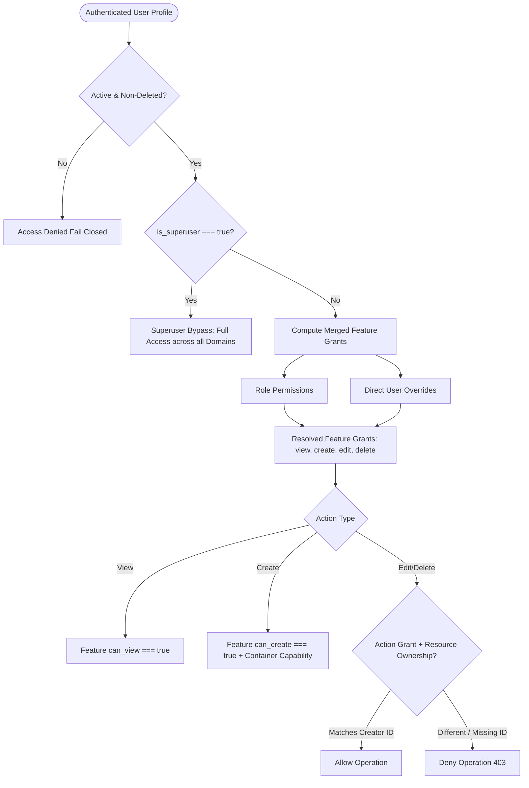

# ARCHICOPRO Extranet — Complete CRUD and Permissions Matrix

This document provides a comprehensive technical reference for the **Role-Based Access Control (RBAC)**, **Resource Ownership Rules**, **CRUD Capabilities**, and **Frontend Authorization Boundaries** implemented across the ARCHICOPRO Extranet (`passarinhama-frontend`).

---

## 1. Authorization Architecture Overview

The extranet implements a multi-layered security model combining system roles, granular domain permissions, explicit per-user overrides, and resource-level ownership validation.

### Core Principles Verified in Source Code:
1. **Authentication & Active Account Requirement**: All protected operations require an active token, valid profile, `status === "active"`, and `is_deleted === false` (`permissionUtils.ts` Line 31). Inactive or soft-deleted superusers fail closed.
2. **Superuser Authority**: Only active accounts with `is_superuser === true` bypass feature grants and ownership checks. Role names or slugs (e.g. `role: "admin"`) **never** confer superuser status on their own.
3. **Independent Action Grants**: The system recognizes four distinct actions per feature: `can_view`, `can_create`, `can_edit`, and `can_delete`. Having `can_create` does not grant `can_edit` or `can_delete`.
4. **Ownership Precedence (`resourceAuthorization.ts`)**: For ordinary users, editing, updating, publishing, and deleting content requires **both** the corresponding action permission **and** immutable resource ownership (matching creator ID in API records).
5. **Direct User Overrides**: Individual `user_permissions` take precedence over role-inherited `permissions`. An explicit `false` override in a user's record revokes an inherited role grant.
6. **Container & Cascade Safeguards**:
   - Creating documents requires `document.create` AND parent folder `folder.can_upload === true`.
   - Creating forum topics requires `forum.create` AND `forum.can_post === true`.
   - Replying to forum threads requires `forum.create` AND `forum.can_post === true` AND `topic.is_locked === false`.
   - Ordinary topic deletion is permitted only when `topic.reply_count === 0` to prevent unauthorized cascade deletion of other members' replies.
   - Categories, forum containers, and document folder deletion require superuser status.
7. **Two-Tier Enforcement (UI & BaseQuery Interceptor)**:
   - UI controls hide or disable buttons via `usePermissions()` and `canModifyResource()`.
   - RTK Query mutation requests are intercepted before network dispatch by `mutationAuthorization.ts`, checking the live user identity, refetching canonical target records, and rejecting unauthorized requests with client-side HTTP 403 errors.

---

## 2. User Roles Hierarchy & Access Scopes

| Role Identifier | Role Name | Intended Role Purpose | UI Access Scope | Executable Code Behavior |
| :--- | :--- | :--- | :--- | :--- |
| `admin` (`is_superuser: true`) | **Administrator / Superuser** | Full organizational governance and extranet management | Unrestricted access to all 9 Admin Panel tabs, Member Directory, all content domains, settings, logs, and backups. | Granted full bypass across all features, containers, and actions. |
| `moderator` | **Moderator** | Content review and forum moderation | Access to forum discussions, articles, directory, and the Moderation Desk. | *Notice*: In executable code, cross-owner moderation and `/moderation` actions require active superuser status. Role slug alone does not grant moderation overrides. |
| `membre` | **Standard Member** | Registered architect of co-ownership | Community forums, published articles, agenda calendar, training registrations, allowed document folders. | Content creation permitted if granted; editing and deleting strictly constrained to self-authored content. |
| `auditeur` | **Auditor** | Association inspection and record oversight | Read-only inspection of documents, training courses, and public association records. | Typically configured with `can_view: true` and all write actions set to `false`. |
| `partenaires_technicopro` | **Technical Partner** | Specialized industrial or technical partners | TechnicoPro library, designated forum commissions, technical articles. | Scoped to permitted categories and technical publications. |
| `comite_coproprietaire` | **Co-ownership Committee** | Advisory board and governance committee | Committee forums, assemblies, governance documents. | Scoped to committee folders and discussions. |

---

## 3. Master CRUD & Permissions Matrix

Legend:
- **✓ (Owner)**: Permitted for the original creator / author who owns the record, provided the user holds the action grant.
- **✓ (Super)**: Permitted exclusively for active superusers (`is_superuser === true`).
- **✓ (All)**: Permitted for any active user holding the general feature grant.
- **✗ (Blocked)**: Blocked or unsupported in the frontend.

| Domain / Resource | CREATE | READ / VIEW | UPDATE / EDIT | DELETE | Additional Operations | Ownership Identification Field | Frontend Enforcement Evidence | Backend Verification Limitations |
| :--- | :---: | :---: | :---: | :---: | :--- | :--- | :--- | :--- |
| **Articles** (`/articles`) | ✓ (`article.create`) | ✓ (`article.view`) | ✓ (Owner + `article.edit`) or ✓ (Super) | ✓ (Owner + `article.delete`) or ✓ (Super) | **Publish**: Owner + `edit` or Super. **Asset Upload**: `uploadFile` scoped to article. **Filter**: Drafts visible only to permitted authors. | `author.id` | `useArticleAuthorization.ts` `Articles.tsx` `mutationAuthorization.ts` | Backend must enforce author immutability and prevent client author spoofing. |
| **Article Categories** | ✓ (Super) | ✓ (`article.view`) | ✓ (Super) | ✓ (Super) | **Dialog**: Native `<dialog>` via `CategoryManagerDialog`. | None (Shared config) | `Articles.tsx:187` `CategoryManagerDialog.tsx` | No user ownership contract; shared configuration restricted to superusers. |
| **Agenda Events** (`/agenda`) | ✓ (`event.create`) | ✓ (`event.view`) | ✓ (Owner + `event.edit`) or ✓ (Super) | ✓ (Owner + `event.delete`) or ✓ (Super) | **Register**: Any viewer. **Unregister**: Self. **Registrations Roster**: Owner or Super. | `created_by.id` | `Agenda.tsx:566` `mutationAuthorization.ts:98` | Server must verify registration roster view authorization. |
| **Event Categories** | ✓ (Super) | ✓ (`event.view`) | ✓ (Super) | ✓ (Super) | **Color Picker**: Supports hex color coding for calendar chips. | None (Shared config) | `Agenda.tsx:1755` `CategoryManagerDialog.tsx` | Superuser-only configuration. |
| **Alternate Calendar** (`/events`) | ✓ (`event.create`) | ✓ (`event.view`) | ✗ (No UI) | ✓ (Owner + `event.delete`) or ✓ (Super) | Quick add month events; duplicate route of Agenda. | `created_by.id` | `Events.tsx:98` `mutationAuthorization.ts` | Reconciled with main Agenda API. |
| **Professional Trainings** (`/trainings`) | ✓ (`training.create`) | ✓ (`training.view`) | ✓ (Owner + `training.edit`) or ✓ (Super) | ✓ (Owner + `training.delete`) or ✓ (Super) | **Attachment Removal**: Tracked via `remove_attachment_urls`. **Syllabus Preview**: Inline view or download. | `created_by.id` | `Trainings.tsx:163` `mutationAuthorization.ts:221` | Server must ensure creator ID cannot be assigned to another user on create. |
| **Training Categories** | ✓ (Super) | ✓ (`training.view`) | ✓ (Super) | ✓ (Super) | Shared category manager dialog. | None (Shared config) | `Trainings.tsx:480` `CategoryManagerDialog.tsx` | Superuser-only configuration. |
| **TechnicoPro Articles** (`/technicopro`) | ✓ (`technicopro.create`) | ✓ (`technicopro.view`) | ✓ (Owner + `technicopro.edit`) or ✓ (Super) | ✓ (Owner + `technicopro.delete`) or ✓ (Super) | **Publish**: Admin panel trigger. **File Removal**: Tracked via `remove_file_urls`. | `author.id` / `author_id` (Conflicts deny) | `TechnicoPro.tsx:158` `resourceAuthorization.ts:15` | If `author.id` and `author_id` disagree, mutation denies access fail-closed. |
| **TechnicoPro Categories** | ✓ (Super) | ✓ (`technicopro.view`) | ✓ (Super) | ✓ (Super) | Shared category manager dialog. | None (Shared config) | `TechnicoPro.tsx:480` `CategoryManagerDialog.tsx` | Superuser-only configuration. |
| **Document Folders** (`/documents`) | ✓ (`document.create` + Parent `can_upload`) | ✓ (`document.view`) | ✓ (Super) | ✓ (Super) | **Nested Folders**: Requires parent folder upload permission. | None (Folder type lacks creator ID) | `DocumentLibrary.tsx:504` `mutationAuthorization.ts:127` | Folder renaming/deletion restricted to superusers because no creator ownership exists. |
| **Document Files** | ✓ (`document.create` + Folder `can_upload`) | ✓ (`document.view`) | ✓ (Owner + `document.edit`) or ✓ (Super) | ✓ (Owner + `document.delete`) or ✓ (Super) | **Rename**: Updates `original_name`. **Download**: Binary blob trigger via `useLazyDownloadDocumentQuery`. **Inspect**: File preview drawer. | `uploaded_by.id` | `DocumentLibrary.tsx:587` `mutationAuthorization.ts:177` | Document files must be validated against containing folder ID on server. |
| **Folder Permissions (Bulk)** | ✗ | ✓ (Super) | ✓ (Super) | ✗ | Bulk update role grants per folder (`PATCH /documents/folder/permissions/bulk`). | N/A | `documentsApi.ts` `mutationAuthorization.ts:26` | Superuser-only admin feature. |
| **Forum Containers** (`/forums`) | ✓ (`forum.create`) | ✓ (`forum.view`) | ✓ (Super) | ✓ (Super) | Type default to `general`; existing non-general types preserved on edit. | None | `Forums.tsx:1330` `mutationAuthorization.ts:20` | Container deletion cascades to all topics/posts; restricted to superusers. |
| **Forum Topics** | ✓ (`forum.create` + Forum `can_post`) | ✓ (`forum.view`) | ✓ (Owner + `forum.edit`) or ✓ (Super) | ✓ (Owner + `forum.delete` + Empty Topic) or ✓ (Super) | **Pin / Unpin**: Superuser only. **Attachments**: Multi-file dropzone. | `author.id` / `author_id` | `Forums.tsx:1342` `mutationAuthorization.ts:154` | Non-empty topics require superuser to delete until cascade authorization exists. |
| **Forum Posts / Replies** | ✓ (`forum.create` + Forum `can_post` + Topic Unlocked) | ✓ (`forum.view`) | ✓ (Owner + `forum.edit`) or ✓ (Super) | ✓ (Owner + `forum.delete`) or ✓ (Super) | **Inline Reply**: Editor on thread view. **Attachments**: Uploads supported. | `author.id` / `author_id` | `Forums.tsx:1055` `resourceAuthorization.ts:46` | Replies require explicit forum `can_post` and unlocked topic. |
| **Member Directory Accounts** (`/directory`) | ✓ (`user.create`) | ✓ (`user.view`) | ✓ (Super) | ✓ (Super) | **Payment Validation**: Superuser. **Restore Account**: Superuser. **CSV Export**: Superuser. **Ordinary Creation**: Privileged fields stripped. | None | `MemberDirectory.tsx:311` `mutationAuthorization.ts:109` | Ordinary users with `user.create` have all role, status, payment, and superuser fields stripped by allowlist. |
| **User Profile (Self)** (`/profile`) | ✗ | ✓ (Self) | ✓ (Self) | ✗ | **Photo Upload**: Scoped to self ID. **Password Reset**: Current password required. **Notification Toggles**: Per user. | `user.id` (Session) | `Profile.tsx` `mutationAuthorization.ts:119` | Self-profile update targets `/user/users/me`. Spoofing target user ID is impossible in frontend. |
| **System Roles & Permissions** (`/admin`) | ✓ (Super) | ✓ (Super) | ✓ (Super) | ✓ (Super) | Role creation, editing, deletion, and 7x4 feature permissions matrix. | N/A | `AdminPermissionsEditor.tsx` `AdminPanel.tsx` | Superuser-only route and API guard. |
| **Direct Member Permissions** (`/admin`) | ✓ (Super) | ✓ (Super) | ✓ (Super) | ✗ | Direct per-member override matrix. | N/A | `AdminPermissionsEditor.tsx` | Superuser-only route and API guard. |
| **Moderation Queue & Logs** (`/admin`) | ✗ | ✓ (Super) | ✓ (Super) | ✗ | **Moderate Post**: Approve, Reject, Flag with required explanation note. | N/A | `AdminPanel.tsx` `mutationAuthorization.ts:94` | Cross-owner moderation restricted to active superusers. |
| **SMTP Configuration** (`/admin`) | ✗ | ✓ (Super) | ✓ (Super) | ✗ | **Test Dispatch**: Live test email trigger. | N/A | `AdminPanel.tsx:2280` | Superuser-only operations. |
| **System Logs** (`/admin`) | ✗ | ✓ (Super) | ✗ | ✓ (Super) | **Download**: `.log` file blob. **Clear**: Purges log entries. | N/A | `AdminPanel.tsx:2420` | Superuser-only operations. |
| **Database & Asset Backups** (`/admin`) | ✓ (Super) | ✓ (Super) | ✓ (Super) | ✓ (Super) | **Run Backup**: Immediate trigger. **Download**: Archive download. **Config**: Frequency schedule. | N/A | `AdminPanel.tsx:2520` | Superuser-only operations. |
| **Global Omnibox Search** | ✗ | ✓ (All Authenticated) | ✗ | ✗ | Queries all content domains; results dynamically filtered by user's viewing grants. | N/A | `DashboardLayout.tsx:374` | Backend search results must independently enforce tenant and resource permissions. |

---

## 4. Role vs. Feature vs. Action Permission Matrix

The following table summarizes the baseline configuration and default behavior for system roles:

| Feature Domain | Action | Superuser (`admin` + flag) | Standard Member (`membre`) | Moderator (`moderator`) | Auditor (`auditeur`) | Partner (`partenaires_technicopro`) | Committee (`comite_coproprietaire`) |
| :--- | :--- | :---: | :---: | :---: | :---: | :---: | :---: |
| **Articles** | View | Yes | Yes | Yes | Yes | Scoped | Yes |
| | Create | Yes | Yes (if granted) | Yes | No | Scoped | No |
| | Edit | Yes (Any) | Owner Only | Owner Only | No | Owner Only | No |
| | Delete | Yes (Any) | Owner Only | Owner Only | No | Owner Only | No |
| **Forums** | View | Yes | Yes | Yes | Yes | Scoped | Yes |
| | Create Container | Yes | No | No | No | No | No |
| | Create Topic | Yes | Yes (if `can_post`) | Yes (if `can_post`) | No | Scoped | Scoped |
| | Edit Topic/Post | Yes (Any) | Owner Only | Owner Only | No | Owner Only | Owner Only |
| | Delete Topic | Yes (Any) | Owner (Empty only) | Owner (Empty only) | No | Owner (Empty only) | Owner (Empty only) |
| | Pin Topic | Yes | No | No | No | No | No |
| **Agenda / Events** | View | Yes | Yes | Yes | Yes | Yes | Yes |
| | Create | Yes | Yes (if granted) | Yes | No | No | No |
| | Edit | Yes (Any) | Owner Only | Owner Only | No | No | No |
| | Delete | Yes (Any) | Owner Only | Owner Only | No | No | No |
| | Register | Yes | Yes | Yes | Yes | Yes | Yes |
| **Trainings** | View | Yes | Yes | Yes | Yes | Scoped | Yes |
| | Create | Yes | Yes (if granted) | Yes | No | No | No |
| | Edit | Yes (Any) | Owner Only | Owner Only | No | No | No |
| | Delete | Yes (Any) | Owner Only | Owner Only | No | No | No |
| **TechnicoPro** | View | Yes | Yes | Yes | Yes | Yes | Yes |
| | Create | Yes | Yes (if granted) | Yes | No | Scoped | No |
| | Edit | Yes (Any) | Owner Only | Owner Only | No | Owner Only | No |
| | Delete | Yes (Any) | Owner Only | Owner Only | No | Owner Only | No |
| **Documents** | View | Yes | Yes | Yes | Yes | Scoped | Scoped |
| | Create Folder | Yes | Yes (if `can_upload`) | Yes (if `can_upload`) | No | No | No |
| | Upload File | Yes | Yes (if `can_upload`) | Yes (if `can_upload`) | No | No | No |
| | Edit File (Rename)| Yes (Any) | Owner Only | Owner Only | No | Owner Only | Owner Only |
| | Delete File | Yes (Any) | Owner Only | Owner Only | No | Owner Only | Owner Only |
| | Delete Folder | Yes | No | No | No | No | No |
| **Directory / Users**| View | Yes | Yes (if granted) | Yes | Yes | No | No |
| | Create Member | Yes (Full) | Delegated (Ordinary fields only) | Delegated | No | No | No |
| | Edit Member | Yes | No | No | No | No | No |
| | Delete Member | Yes | No | No | No | No | No |
| | Export CSV | Yes | No | No | No | No | No |
| **Admin Panel** | Access | Yes | No | No | No | No | No |
| **Moderation Desk** | Review / Decision | Yes | No | No | No | No | No |
| **SMTP / Settings** | Manage | Yes | No | No | No | No | No |
| **System Logs** | View / Download / Clear | Yes | No | No | No | No | No |
| **Backups** | Configure / Run / Download / Delete | Yes | No | No | No | No | No |

---

## 5. Security & Verification Disclosures

1. **Frontend Safeguards vs. Backend Enforcement**: All client-side checks (UI disabling, permission hooks, and `mutationAuthorization.ts` interceptors) serve as **user-experience safeguards**. They cannot prevent direct API abuse through automated HTTP clients if backend verification is missing.
2. **Delegated Account Creation Allowlist**: When an ordinary user with `user.create` submits an account form, the frontend automatically strips `role_id`, `status`, `is_payment_validated`, and `is_superuser`. If the backend API requires `role_id` to be present in the request body, ordinary account creation will fail until the backend implements a safe default assignment policy.
3. **Shared Container Modifications**: Categories, document folders, and forum containers do not possess authenticated creator IDs in the current frontend contracts. Consequently, ordinary modification of these shared resources is disabled, and management is restricted to superusers.
4. **Cascade Deletions**: Because there is no atomic backend cascade authorization guarantee, ordinary topic creators are restricted to deleting topics with `reply_count === 0`. Deletion of active discussions containing other members' posts is reserved for superusers.
5. **Standalone File Deletion**: Standalone URL-based file deletion (`POST /articles/file-delete`) carries no parent or file-ownership metadata. The frontend restricts this operation strictly to superusers to prevent unauthorized removal of arbitrary server assets.

